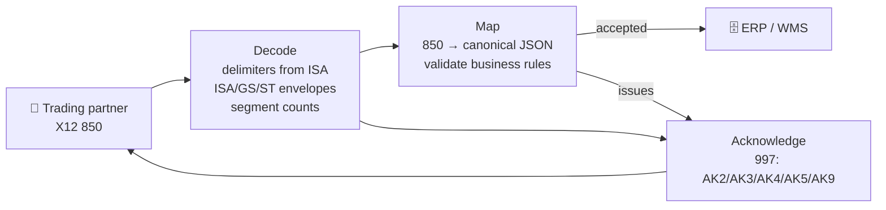

<div align="center">

# 📦 edi-x12-mapper

**An X12 850 purchase order in, canonical JSON out, and a 997 back to the trading partner. The BizTalk EDI pipeline, in about 250 lines of Python.**

[](https://github.com/atonyhonesto/edi-x12-mapper/actions/workflows/ci.yml)


Companion code for my LinkedIn articles<br>
**[Matillion and BizTalk: Two Platforms, One Purpose →](https://www.linkedin.com/pulse/matillion-biztalk-two-platforms-one-purpose-tony-honesto-mfkcc/)**<br>
**[Microsoft Integration Accounts now enhanced in Logic Apps →](https://www.linkedin.com/pulse/microsoft-integration-accounts-now-enhanced-logic-apps-tony-honesto-zwucc/)**

</div>

---

## Why this exists

Every EDI platform, BizTalk, Logic Apps with an Integration Account, or a SaaS VAN, does the same three jobs: **decode** the interchange and check its envelopes, **map** the partner's document to the shape your systems use, and **acknowledge** what was received so the partner knows what got through. This repo does all three for an 850 purchase order with no dependencies, so the moving parts are visible.



## Run it

```bash
git clone https://github.com/atonyhonesto/edi-x12-mapper.git
cd edi-x12-mapper
python demo.py                    # both sample interchanges
python -m unittest -v             # 10 tests
```

Real output for the batch with one good and one bad order (the good order's full JSON is printed for `850_good.edi`):

```text
=== 850_batch_with_errors.edi: interchange 000000102 from RETAILCO to PARTSWAREHOUSE, delimiters '*' '>' '~'
--- 850 0001: accepted, canonical JSON for the ERP:
    PO PO-48213, 3 lines, total 1252.80
--- 850 0002: REJECTED
    SE     SE01 says 9 segments, counted 6
    BEG03  BEG03 (purchase order number) is required
    BEG05  BEG05 '2026-10-05' is not a valid date
    PO102  PO102 quantity and PO104 price must be numeric
    CTT01  CTT01 says 2 lines, found 1
    N1     no ship-to party (N1*ST)
--- 997 sent back:
    ISA*00*          *00*          *ZZ*PARTSWAREHOUSE *ZZ*RETAILCO       *261005*0931*U*00401*000000001*0*P*>~
    GS*FA*PARTSWAREHOUSE*RETAILCO*20261005*0931*1*X*004010~
    ST*997*0001~
    AK1*PO*102~
    AK2*850*0001~
    AK5*A~
    AK2*850*0002~
    AK3*BEG*2**8~
    AK4*3**1~
    AK4*5**8~
    AK3*PO1*4**8~
    AK4*2**6~
    AK3*CTT*5**8~
    AK4*1**7~
    AK3*N1***3~
    AK5*R*4~
    AK9*P*2*2*1~
    SE*16*0001~
    GE*1*1~
    IEA*1*000000001~
```

The bad order is rejected with every problem pointed at precisely: `AK3*BEG*2**8` says segment 2 (BEG) has element errors, and the `AK4` lines beneath it name element 3 (code 1, required element missing) and element 5 (code 8, invalid date). `AK5*R*4` rejects the transaction because its SE segment count is wrong, and `AK9*P` tells the partner the group was partially accepted.

## What it handles

| Concern | Here | BizTalk / Logic Apps equivalent |
|---|---|---|
| Delimiters | Read from the fixed-width ISA (element, component, segment terminator) | EDI disassembler / X12 Decode |
| Envelopes | ISA13 ↔ IEA02, GS06 ↔ GE02, ST02 ↔ SE02, SE01 and GE01 counts | Envelope validation in the agreement |
| Mapping | BEG, REF, DTM, N1/N3/N4 loops, PO1 with qualifier/value ID pairs, PID, CTT | BizTalk map (XSLT) / Liquid or XSLT map in the Integration Account |
| Business rules | Required PO number, valid dates, numeric quantities, CTT line count, a ship-to party | Custom pipeline component / workflow validation |
| Acknowledgment | 997 with sender/receiver swapped, AK3/AK4 grouped per segment | Auto-generated 997 from the agreement settings |

## Project layout

```text
x12map/
  parser.py     delimiters, segments, envelopes and Issue codes
  map850.py     850 → canonical purchase order
  ack997.py     997 functional acknowledgment
samples/        a clean 850 and a batch with one bad order
demo.py         decode, map and acknowledge both samples
tests/          parser, mapper and 997 tests
```

## In production you would add

- **Schema validation** against the partner's implementation guide (X12 version, required loops, code lists).
- **TA1** interchange acknowledgments and **999** for 5010 partners.
- **Control-number tracking** to catch duplicates and gaps per partner.
- **AS2** or SFTP transport, with MDN receipts.

From the field: I led a BizTalk → Azure Integration Services migration for a logistics company's high-volume EDI platform. The program write-up is in **[biztalk-azure-modernization](https://github.com/atonyhonesto/biztalk-azure-modernization)**.

---

<sub>Built by **Tony Honesto**, cloud & integration engineer. More articles and companion code: [github.com/atonyhonesto](https://github.com/atonyhonesto) · [article-labs](https://github.com/atonyhonesto/article-labs) · [LinkedIn](https://www.linkedin.com/in/tony-honesto-4195023)</sub>
